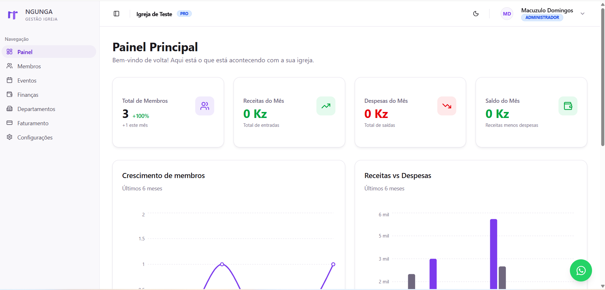
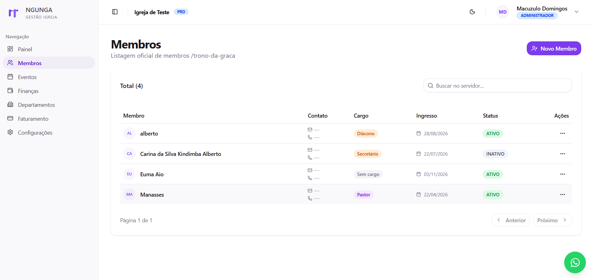
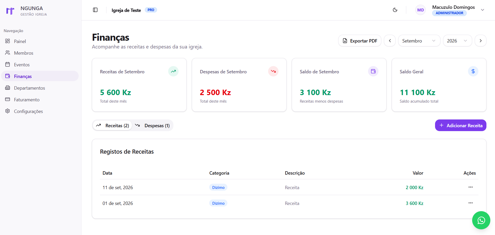

# Ngunga — Church Management SaaS

**A Full-Stack SaaS platform designed to simplify church administration, member management, events, and financial operations.**

[Live Demo](https://www.ngunga.com/pt/)

## Overview

Ngunga is a multi-tenant church management platform built to help churches organize their daily operations through a centralized digital system.

The platform provides tools for managing church members, organizing events, tracking financial activities, managing departments, and controlling access based on user roles.

The project was designed with scalability, maintainability, and a structured multi-tenant architecture in mind.

## Application Screenshots

### Dashboard

The main dashboard provides an overview of church activities and key operational indicators.



### Member Management

Manage church member records through a centralized interface.



### Financial Management

Track church revenues and expenses through the financial management module.



## Key Features

- **Member Management:** Organize and manage church member records.
- **Event Management:** Create and manage church events.
- **Financial Management:** Track financial transactions, including revenues and expenses.
- **Department Management:** Organize church departments.
- **Role-Based Access Control:** Different permissions for administrators, treasurers, secretaries, and operators.
- **Multi-Tenant Architecture:** Support multiple churches within the same platform, with separated organizational data.
- **Subscription Management:** Free, Pro, and Enterprise subscription plans.
- **Internationalization:** Multilingual application support.
- **Dashboard and Analytics:** Visualize important operational and financial information.
- **Audit Logging:** Maintain records of relevant administrative actions.

## Tech Stack

| Category | Technologies |
|---|---|
| Frontend | Next.js, React, TypeScript |
| Styling | Tailwind CSS, Radix UI |
| Backend | Next.js App Router |
| Database | PostgreSQL |
| ORM | Prisma |
| Authentication | Auth.js |
| Internationalization | next-intl |
| Charts | Recharts |
| Monitoring | Sentry |
| Email | Resend |

## Architecture Highlights

- Multi-tenant application architecture.
- Role-based authorization and access control.
- Relational database management with PostgreSQL and Prisma.
- Server-side functionality using Next.js App Router.
- Reusable and modular components.
- Subscription-based SaaS structure.

## Getting Started

### Prerequisites

- Node.js
- npm
- PostgreSQL database

### Installation

Clone the repository:

```bash
git clone https://github.com/macuzulodomingos/gestao-igreja-saas.git
```

Navigate to the project directory:

```bash
cd gestao-igreja-saas
```

Install dependencies:

```bash
npm install
```

Configure the environment variables using the project's environment configuration.

Run database migrations and generate the Prisma Client according to the project's Prisma configuration.

Start the development server:

```bash
npm run dev
```

Open [http://localhost:3000](http://localhost:3000) in your browser.

## Project Status

Ngunga is an actively developed project.

## Live Application

Explore the application:

**https://www.ngunga.com/pt/**

## Author

**Manasses Domingos**

Full-Stack Developer focused on building web applications and SaaS platforms.

- GitHub: [@macuzulodomingos](https://github.com/macuzulodomingos)
