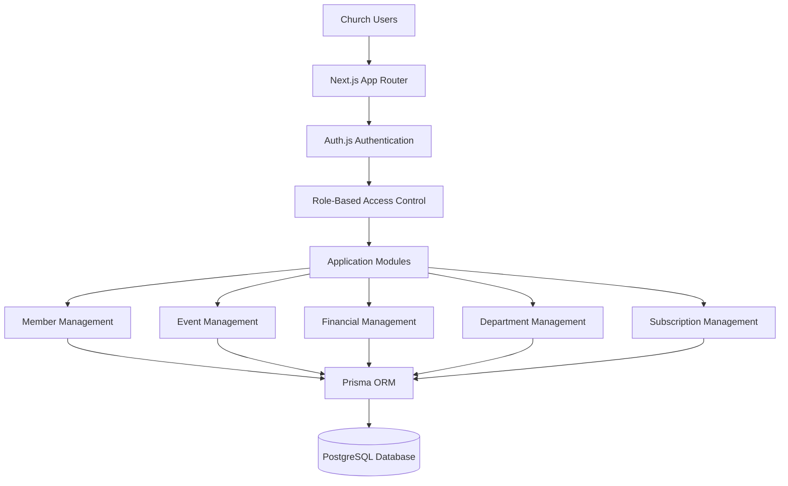

# Ngunga — Church Management SaaS

A multi-tenant SaaS platform designed to help churches manage members, events, departments, finances, and administrative operations through a centralized platform.

**Live Application:** https://www.ngunga.com/pt/  
**Repository:** https://github.com/macuzulodomingos/gestao-igreja-saas

---

## Overview

Ngunga is a full-stack church management platform built to simplify administrative and operational processes for churches.

The platform provides an integrated environment where each church can manage its members, organize events, track financial transactions, manage departments, and control access based on user roles.

Designed with a multi-tenant architecture, Ngunga supports multiple churches within a shared application while associating organizational records with their respective church.

The project also includes a subscription management system with different pricing plans and administrative payment verification.

## Key Features

### Church Management
- Centralized church administration.
- Church-specific organizational data.
- Configurable church settings and timezone.

### Member Management
- Register, update, search, and manage church members.
- Assign members to organizational roles.
- Track member status and joining dates.
- Soft deletion to preserve historical records.
- Member history and audit tracking.

### Event Management
- Create and manage church events.
- Organize events using categories.
- Manage event attendance and member participation.

### Financial Management
- Record church revenues and expenses.
- Organize transactions using financial categories.
- Track financial activity through a centralized interface.

### Department Management
- Create and manage church departments.
- Assign department leaders.
- Organize members within departments.

### Authentication and Access Control
- Email and password authentication.
- Password verification using bcrypt.
- Role-based access control.
- JWT-based session management.
- Periodic session data refresh.

Supported roles:
- `SUPER_ADMIN`
- `ADMIN`
- `TREASURER`
- `SECRETARY`
- `OPERATOR`

### Subscription and Billing Management
- FREE, PRO, and ENTERPRISE plans.
- Monthly and annual billing cycles.
- Payment proof submission.
- Manual payment verification by administrators.
- Subscription activation and expiration management.
- Plan-based usage limits.
- Subscription activity tracking.

### Administration and Auditing
- Administrative audit logs.
- Tracking of relevant user actions.
- Recording of changes to business entities.
- Super administrator functionality.
- Church context selection for administrative operations.

---

## Technology Stack

| Category | Technologies |
|---|---|
| Framework | Next.js 16 |
| Frontend | React 19, TypeScript |
| Styling | Tailwind CSS 4 |
| UI Components | shadcn/ui, Radix UI |
| Authentication | Auth.js |
| ORM | Prisma 7 |
| Database | PostgreSQL |
| Database Hosting | Supabase |
| Internationalization | next-intl |
| Charts | Recharts |
| Validation | Zod |
| Password Hashing | bcryptjs |
| Notifications | Sonner |
| Monitoring | Sentry |
| Email | Resend |
| Rate Limiting | Upstash Redis |

---

## System Architecture

Ngunga follows a modular full-stack architecture using the Next.js App Router.

The application separates authentication, access control, business logic, and database operations into dedicated layers.

### High-Level Architecture



### Multi-Tenant Data Model

Churches act as the central organizational entities within the application.

Each church has associated users, members, departments, events, financial records, and subscription information.

The database uses church relationships and tenant-scoped queries to associate organizational data with the corresponding church.

### Authentication and Authorization

Authentication is implemented using Auth.js with a credentials-based provider.

Key implementation details:

- Password verification using bcrypt.
- JWT-based session strategy.
- Eight-hour session lifetime.
- Periodic user data refresh from the database.
- Role and church context included in the session.
- Access restrictions for users without a valid church association, except for the global super administrator.

### Database Architecture

Ngunga uses PostgreSQL with Prisma ORM to manage a relational data model.

Important design decisions include:

- Relational models connected through foreign keys.
- Church-level data relationships.
- Composite indexes for frequently queried member records.
- Soft deletion using `deletedAt` on selected entities.
- Audit records containing action, actor, entity, and change information.
- A partial unique index to enforce email uniqueness among active members within the same church.

### Transactional Operations

Prisma transactions are used for related database operations that need to succeed or fail together.

Examples include:

- Creating members and their corresponding audit records.
- Updating member information and recording changes.
- Confirming subscription payments.
- Updating church subscription plans and recording administrative actions.

---

## Subscription Plans

Ngunga includes three subscription tiers.

| Feature | FREE | PRO | ENTERPRISE |
|---|---:|---:|---:|
| Monthly price | Free | 5,000 Kz | 15,000 Kz |
| Annual price | — | 55,000 Kz | 165,000 Kz |
| Member limit | 50 | 500 | Configured limit |
| Events | Usage limit | Usage limit | Configured limit |
| Transactions | Usage limit | Usage limit | Configured limit |

The application includes backend checks for member, user, department, event, and financial transaction limits.

---

## Application Screenshots

### Dashboard

The main dashboard provides an overview of church activities and operational indicators.


### Member Management

A centralized interface for managing church member records.


### Financial Management

The financial module provides tools for recording and managing church revenues and expenses.


---

## Internationalization

Ngunga includes internationalization support using `next-intl`.

The application currently includes Portuguese and French language configuration.

Church timezone configuration is also supported, with `Africa/Luanda` as the default timezone.

---

## Getting Started

### Prerequisites

- Node.js
- npm
- PostgreSQL database
- Git

### Installation

Clone the repository:

```bash
git clone https://github.com/macuzulodomingos/gestao-igreja-saas.git
```

Navigate into the project:

```bash
cd gestao-igreja-saas
```

Install dependencies:

```bash
npm install
```

Configure the environment variables required by the application using the provided environment example or project configuration.

Generate the Prisma Client and apply the required database migrations according to the project's Prisma configuration.

Start the development server:

```bash
npm run dev
```

Open http://localhost:3000 in your browser.

---

## Project Status

Ngunga is deployed and accessible through its live application.

The platform includes church administration, member management, event management, financial operations, access control, and subscription management.

---

## Author

**Developed by [Macuzulo Domingos](https://github.com/macuzulodomingos/)**

Full-Stack Developer focused on building web applications and practical software solutions.

GitHub: https://github.com/macuzulodomingos/
